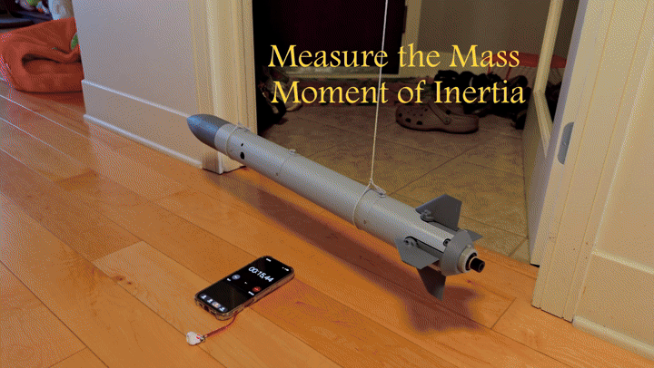
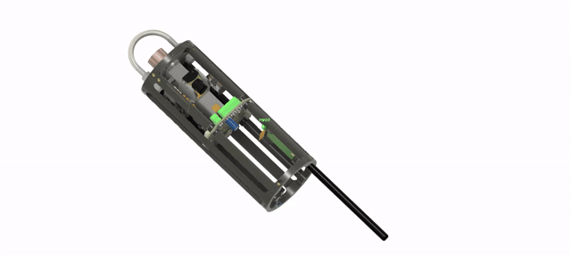
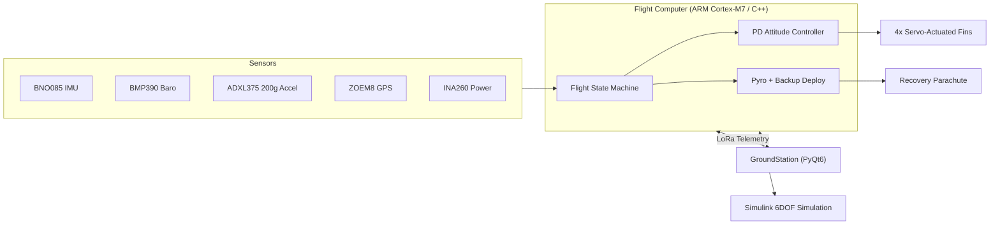
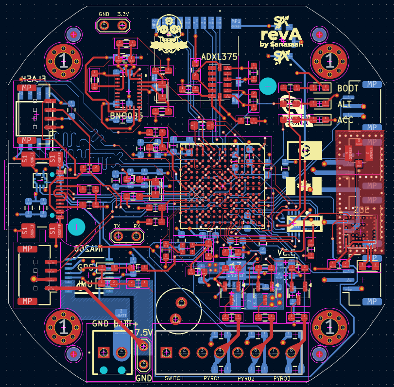
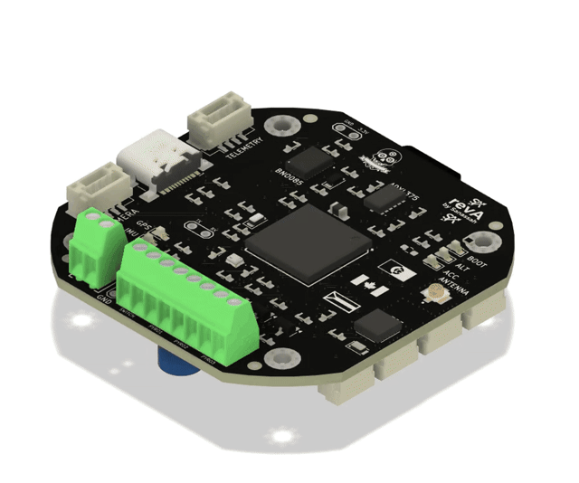
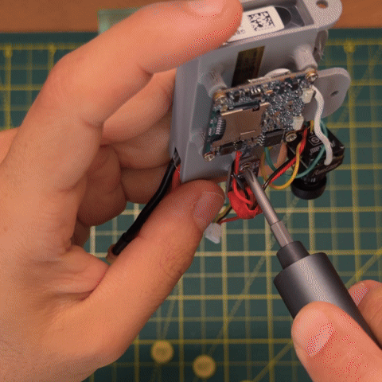
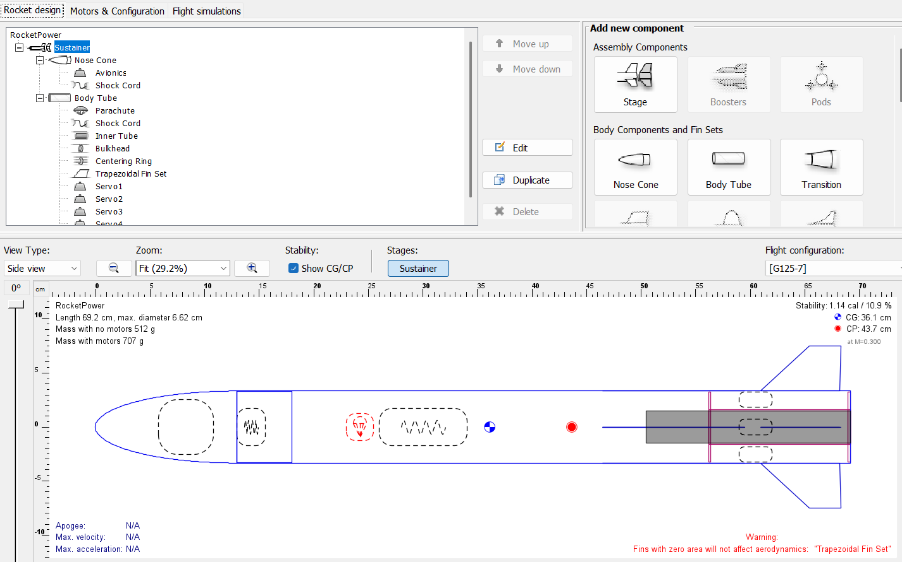

# RocketPower

A full powered ascent, coast, and parachute deployment, run entirely in hardware-in-the-loop: real flight computer, simulated flight.

A model rocket built from the ground up: custom flight computer, custom PCB, active fin stabilization, and a full hardware-in-the-loop test rig, as a self-directed project to go deep on PCB design, embedded control systems, and systems simulation.

**Status:** in bench and hardware-in-the-loop validation ahead of first flight. See [`PRs/PROBLEM_REPORTS.md`](PRs/PROBLEM_REPORTS.md) for the live, dated log of everything open, fixed, and ruled out.

## What it does

- **Active attitude control.** An ARM Cortex-M7 flight computer runs a PD controller on quaternion-derived tilt plus gyro rate, driving 4 independent servo fins in real time to actively stabilize ascent.
- **Redundant recovery deployment.** Apogee detection runs on multiple independent signals (fused IMU/baro vertical velocity, raw barometric altitude, and a fully independent backup flight-state monitor), each able to trigger deployment on its own rather than sharing a single point of failure.
- **Hardware-in-the-loop testing.** A custom 6DOF rigid-body Simulink model drives the *real* flight computer over serial, closing the control loop in simulation so active stabilization can be validated before ever flying.
- **Custom PCB.** A from-scratch board (KiCad) integrating the IMU, barometer, high-g accelerometer, GPS, power monitoring, pyro firing/continuity, and LoRa telemetry.
- **Ground station.** A PyQt6 desktop app for live telemetry, 3D orientation visualization, command/control, and bench test tooling.

Servo-actuated fin mechanism, CAD animation.

## Architecture

## Repository layout

| Path | What's there |
|---|---|
| [`FlightComputer/`](FlightComputer) | Flight computer firmware (PlatformIO, C++). State machine, sensor fusion, PD attitude control, pyro/recovery logic, telemetry. |
| [`GroundStation/`](GroundStation) | PyQt6 desktop app. Live telemetry, 3D orientation view, command/control, bench test tooling. |
| [`Simulation/`](Simulation) | Custom 6DOF Simulink model: aerodynamics, motor curve, moment of inertia from the real airframe. Used both for control tuning and as the hardware-in-the-loop test engine. |
| [`PCB/`](PCB) | KiCad schematic and PCB design for the custom flight computer board. |
| [`OpenRocket/`](OpenRocket) | OpenRocket performance simulations, cross-checked against the custom sim. |
| [`PRs/`](PRs) | Dated problem-report log: symptom, investigation, root cause, mitigation, and what's left open for every issue found during development. |
| [`Documentation/`](Documentation) | Build docs, flight procedure, pinout references. |
| [`Media/`](Media) | Project photos and build videos. |

## Hardware

Custom board, designed from scratch in KiCad: flight computer, IMU, barometer, high-g accelerometer, GPS, power monitoring, pyro firing and continuity sensing, all on one PCB.

Assembling the avionics bay: flight computer, antenna, and wiring harness into the airframe.

## Simulation and testing

Rocket performance (altitude, velocity, stability margin) is modeled in OpenRocket and cross-checked against a custom 6DOF Simulink model built with the real airframe's mass properties. That same Simulink model doubles as the hardware-in-the-loop test engine, feeding simulated flight dynamics to the real flight computer over serial so the active control loop can be validated on the bench, before it ever has to work for real.

## Why the problem-report log matters

Most of the real engineering here isn't visible in a diff. It's in how a bug got found and ruled in or out. [`PRs/PROBLEM_REPORTS.md`](PRs/PROBLEM_REPORTS.md) tracks every known issue with what was actually tested to rule out each candidate cause, not just the eventual fix, so investigation already done never gets repeated or lost.

## Tech stack

Embedded C++ (PlatformIO, Arduino framework) · Python (PyQt6) · MATLAB/Simulink · KiCad · OpenRocket

## License

MIT, see [`LICENSE`](LICENSE).
