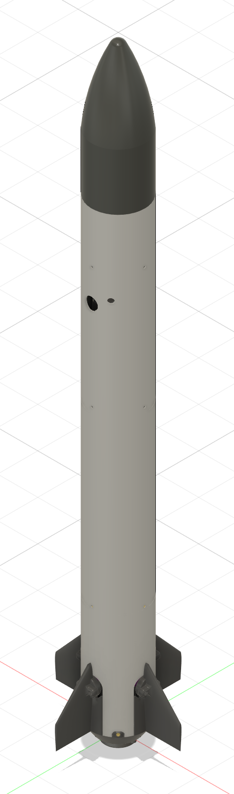
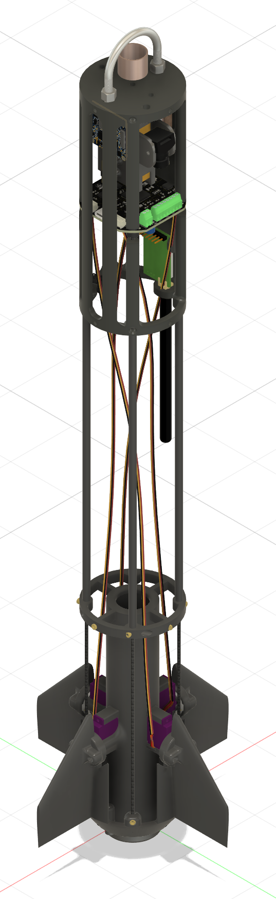
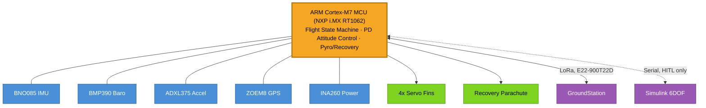
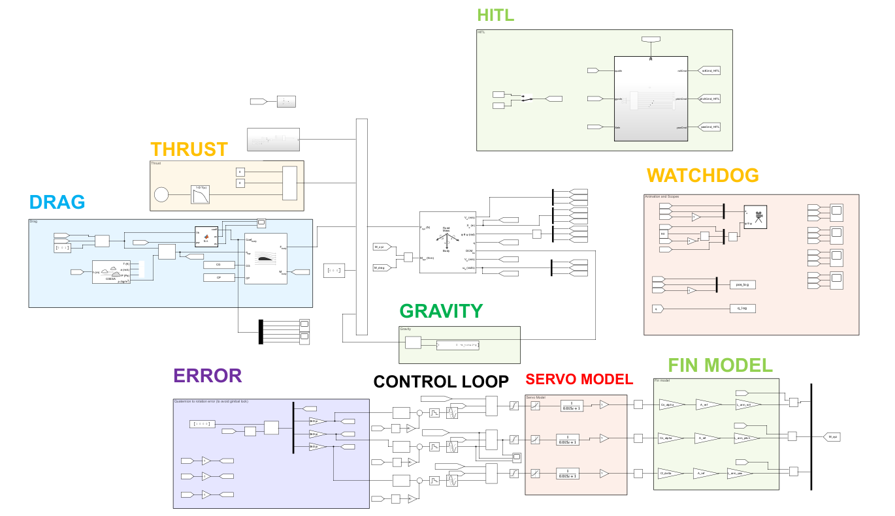
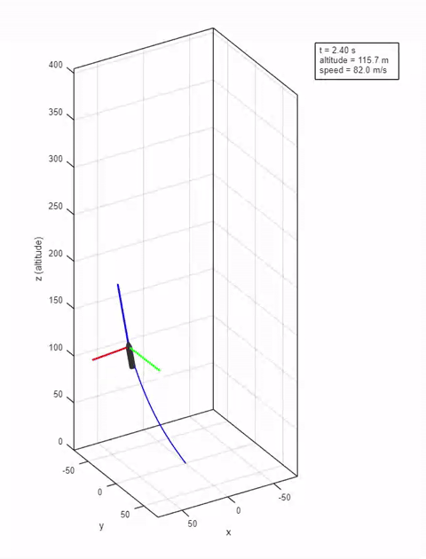

# RocketPower

<table><tr>
<td></td>
<td></td>
</tr></table>

A model rocket built **from the ground up**: custom flight computer, custom PCB, active fin stabilization, and a full hardware-in-the-loop test rig.

**Status:** in bench and hardware-in-the-loop validation ahead of first flight.

---

## 🔧 Putting it together

<table><tr>
<td></td>
<td></td>
</tr></table>

---

## 🚀 What it does

- **Active attitude control.** An ARM Cortex-M7 flight computer runs a PD controller on quaternion-derived tilt plus gyro rate, driving **4 independent servo fins** in real time.
- **Redundant recovery.** Apogee detection runs on multiple independent signals, each able to trigger deployment on its own.
- **Hardware-in-the-loop testing.** A custom 6DOF Simulink model drives the real flight computer over serial, so the control loop gets validated **before it ever has to fly**.
- **Custom PCB.** IMU, barometer, high-g accelerometer, GPS, power monitoring, pyro firing and continuity, and LoRa telemetry, all on one board.
- **Ground station.** A PyQt6 desktop app for live telemetry, 3D orientation, and command/control.

---

## 🧠 Architecture

One MCU reads every sensor, runs the control law, and drives every output. Nothing else on the vehicle makes a decision.

---

## 🛠️ Hardware

Every subsystem on one custom board: IMU, barometer, high-g accelerometer, GPS, power monitoring, pyro firing/continuity, and telemetry.

<table><tr>
<td></td>
<td></td>
</tr></table>

---

## 🧪 Simulation and testing

Performance is modeled before anything is built, and the same model closes the loop with real hardware once it exists.

<table><tr>
<td></td>
<td></td>
</tr></table>

A full powered ascent, coast, and parachute deployment, run entirely in hardware-in-the-loop: **real flight computer, simulated flight.**

---

Where this is headed.

