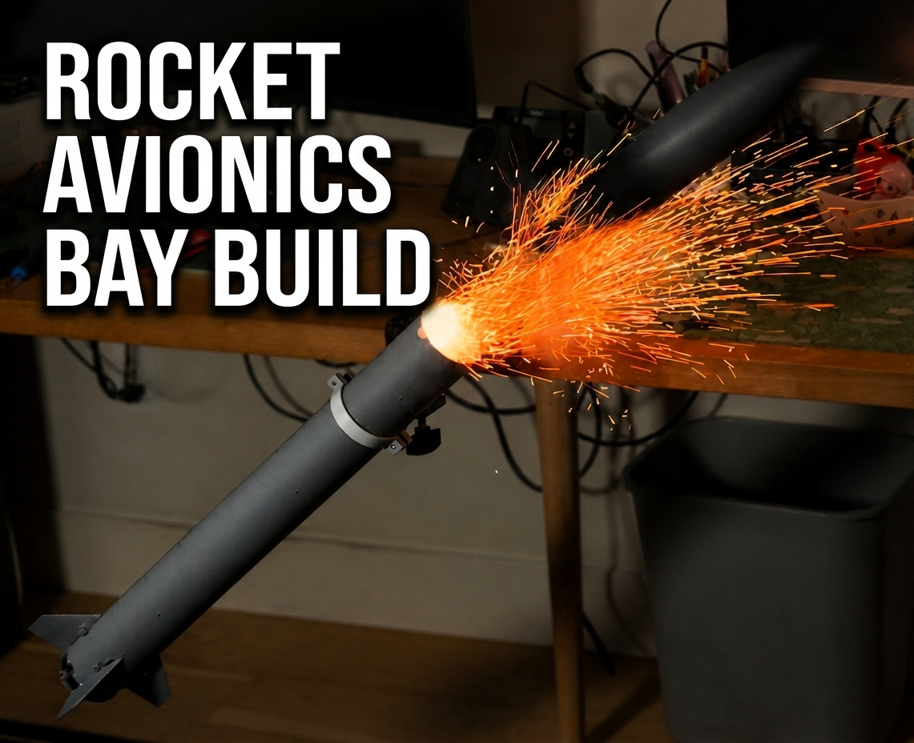
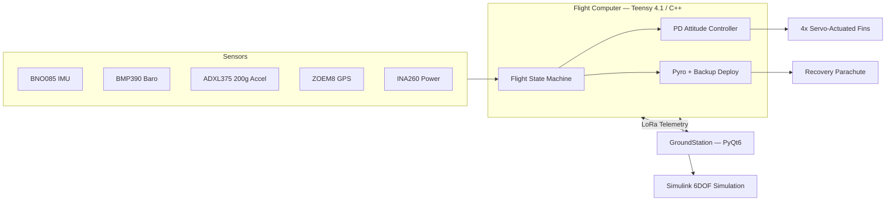

# RocketPower

A model rocket built from the ground up — custom flight computer, custom PCB, active fin stabilization, and a full hardware-in-the-loop test rig — as a self-directed project to go deep on PCB design, embedded control systems, and systems simulation.

**Status:** in bench + hardware-in-the-loop validation ahead of first flight. See [`PRs/PROBLEM_REPORTS.md`](PRs/PROBLEM_REPORTS.md) for the live, dated log of everything open, fixed, and ruled out.

## What it does

- **Active attitude control** — a Teensy 4.1-class flight computer runs a PD controller on quaternion-derived tilt + gyro rate, driving 4 independent servo fins in real time to actively stabilize ascent.
- **Redundant recovery deployment** — apogee detection runs on multiple independent signals (fused IMU/baro vertical velocity, raw barometric altitude, and a fully independent backup flight-state monitor), each able to trigger deployment on its own rather than sharing a single point of failure.
- **Hardware-in-the-loop testing** — a custom 6DOF rigid-body Simulink model drives the *real* flight computer over serial, closing the control loop in simulation so active stabilization can be validated before ever flying.
- **Custom PCB** — a from-scratch board (KiCad) integrating the IMU, barometer, high-g accelerometer, GPS, power monitoring, pyro firing/continuity, and LoRa telemetry.
- **Ground station** — a PyQt6 desktop app for live telemetry, 3D orientation visualization, command/control, and bench test tooling.

## Architecture

## Repository layout

| Path | What's there |
|---|---|
| [`FlightComputer/`](FlightComputer) | Teensy 4.1 firmware — PlatformIO, C++. State machine, sensor fusion, PD attitude control, pyro/recovery logic, telemetry. |
| [`GroundStation/`](GroundStation) | PyQt6 desktop app — live telemetry, 3D orientation view, command/control, bench test tooling. |
| [`Simulation/`](Simulation) | Custom 6DOF Simulink model — aerodynamics, motor curve, moment-of-inertia from the real airframe. Used both for control tuning and as the hardware-in-the-loop test engine. |
| [`PCB/`](PCB) | KiCad schematic + PCB design for the custom flight computer board. |
| [`OpenRocket/`](OpenRocket) | OpenRocket performance simulations, cross-checked against the custom sim. |
| [`PRs/`](PRs) | Dated problem-report log — symptom, investigation, root cause, mitigation, and what's left open for every issue found during development. |
| [`Documentation/`](Documentation) | Build docs, flight procedure, pinout references. |
| [`Media/`](Media) | Project photos and build videos. |

## Why the problem-report log matters

Most of the real engineering here isn't visible in a diff — it's in how a bug got found and ruled in or out. [`PRs/PROBLEM_REPORTS.md`](PRs/PROBLEM_REPORTS.md) tracks every known issue with what was actually tested to rule out each candidate cause, not just the eventual fix, so investigation already done never gets repeated or lost.

## Tech stack

Embedded C++ (PlatformIO / Teensyduino) · Python (PyQt6) · MATLAB/Simulink · KiCad · OpenRocket

## License

MIT — see [`LICENSE`](LICENSE).
